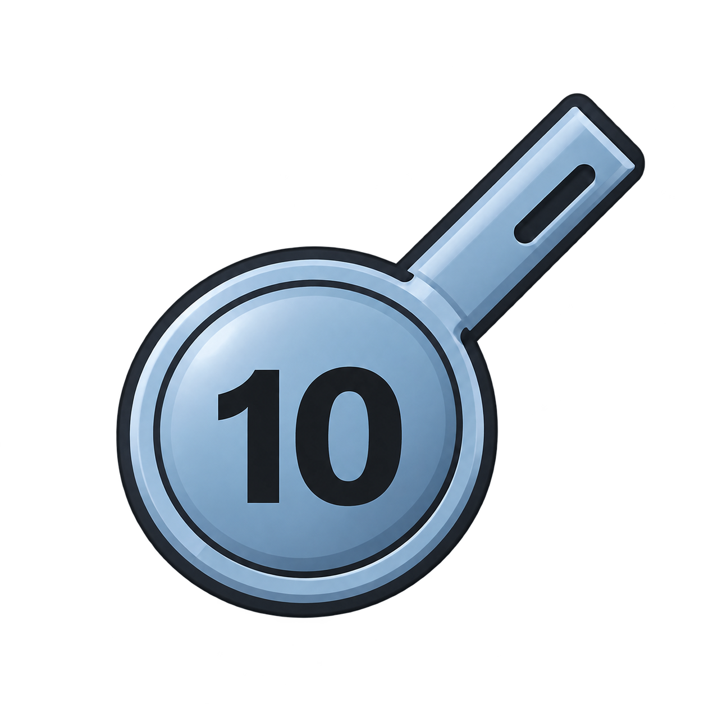
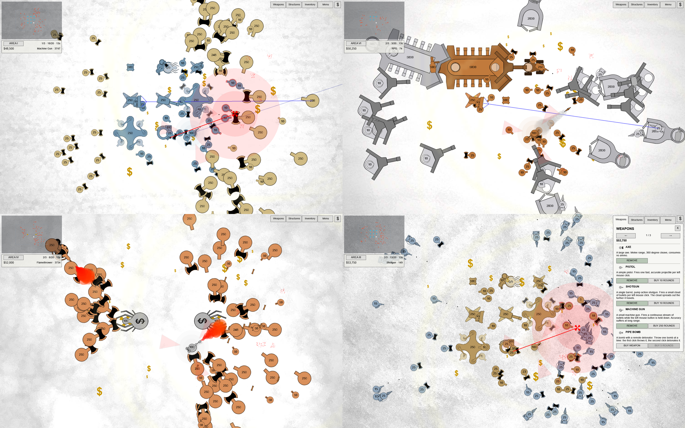

<h1> PyDrone</h1>

A Python 3.14t and [pyglet](https://pyglet.org/) remake of old David W. Wilson's game
[Drone](https://web.archive.org/web/20131019214115/http://dwwilson.info/?page_id=14) (2010), originally built with GameMaker 8.0.

Game logic is rewritten in Python using the original sprites and sounds.

## Run

Create a Python 3.14t (free-threaded) environment. Then install requirements and run main file.

```powershell
py install 3.14t
py -3.14t -m venv .venv
.venv/bin/pip install -r requirements.txt
.venv/bin/python main.py
```

Installing other packages may enable GIL - that's why you use virtual environment.

## Build

```powershell
.venv/bin/pip install pyinstaller
.venv/bin/pyinstaller --onefile --windowed --add-data "data;data" --icon="data/assets/icon.ico" --name=PyDrone "main.py"
```

## Showcase



## Why?

- Play nastolgia childhood game
- Test out parallel python
- Maybe somewhen add multiplayer mode

## Drone
Since original game lost by the time I [uploaded setup file](https://disk.yandex.ru/d/INGeUuv2HZIymw) from ~2010 so you can play it!

Drone was decompiled using [GM8Decompiler](https://github.com/OpenGMK/GM8Decompiler) by OpenGMK (authors of GameMaker).

## Credits
- [**David W. Wilson**](https://web.archive.org/web/20130523145527/http://dwwilson.info/) - original game creator
- [**MrGeRoI**](https://github.com/MrGeRoI) - remake author
- [**OpenGMK**](https://github.com/OpenGMK) - decompiler authors
- [**YoYo Games**](https://gamemaker.io/) - game engine authors
- [**ChatGPT-6.1 Sol (OpenAI)**](https://chatgpt.com/overview/) - AI assistant
